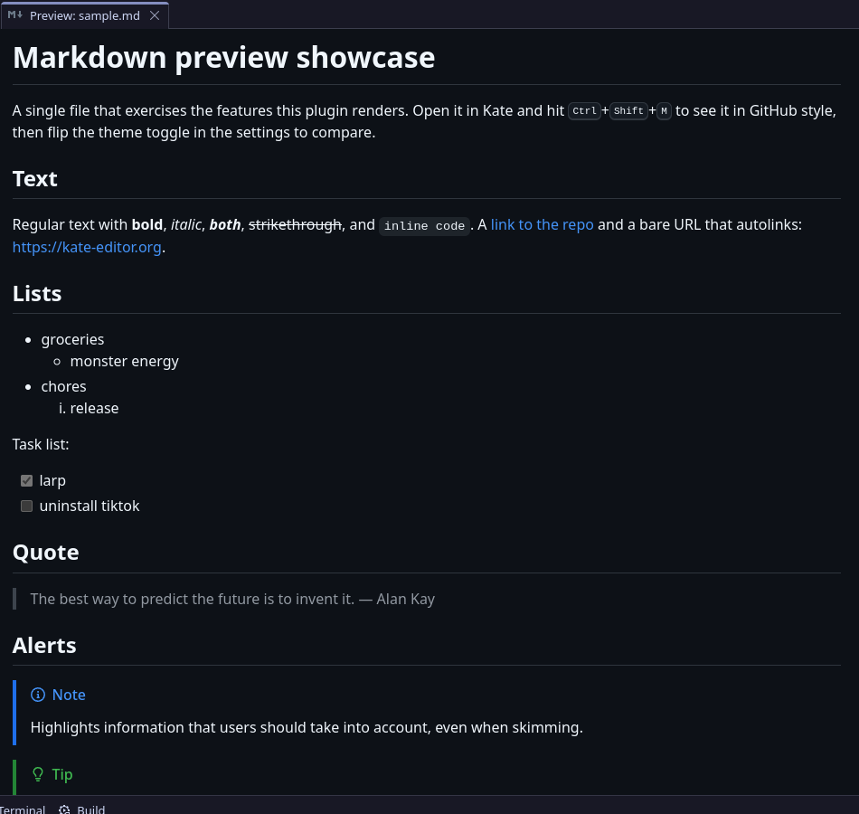
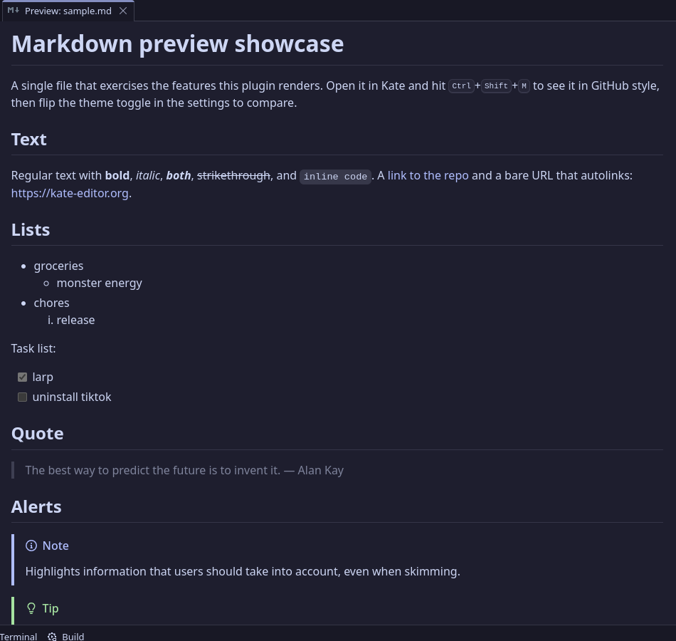
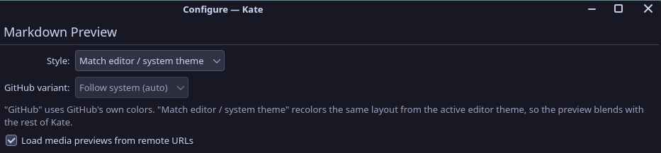
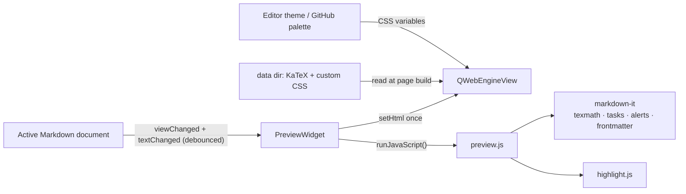

<div align="center">

# Katexdown

**Markdown preview for Kate in a side panel: KaTeX math, custom stylesheets,
follows the active document. A katdown fork — GitHub theme by default, with the
built-in stylesheet optional and replaceable.**

[](LICENSE)
&nbsp;
&nbsp;

</div>

This is a fork of [katdown](https://github.com/uwuclxdy/katdown) that renames it
to **Katexdown** (so it is unmistakably not vanilla katdown and can even be
installed next to it) and adds: a preview panel that follows the active
document, KaTeX math, custom stylesheets, a built-in-GitHub-CSS on/off switch,
and HTML export.

It renders with the actual [github-markdown-css](https://github.com/sindresorhus/github-markdown-css), so headings, tables, blockquotes, task lists, and alerts match github.com by default. Fully offline.

## Screenshots

| GitHub style | Theme-matched style |
| :----------: | :-----------------: |
|  |  |

## Installation

### Arch Linux (recommended)

### Arch Linux (local package, no AUR entry needed)

The repository ships a ready-made PKGBUILD. Build it straight from this folder
(makepkg takes care of dependencies and installation):

```bash
cd katexdown/aur        # the aur/ directory inside this repository
makepkg -f -si          # installs katexdown-git system-wide
```

The `-f` forces a rebuild — whenever you change the source, old package
archives in `aur/` would otherwise make makepkg silently reinstall the previous
build instead of compiling the new code.

Then enable it: Settings -> Configure Kate -> Plugins -> check **Katexdown**.

> [!NOTE]
> `aur/PKGBUILD` is intentionally a repository-local development recipe. It
> uses a `git+file://` source and overlays the current working tree, so it is
> not the recipe to copy into an AUR checkout, and there is no AUR publish
> workflow. To distribute via the AUR you would need a separate `pkgname`
> and an `https`/`git` source pointing at the pushed fork.

### Arch Linux testing package (Vim navigation)

The `testing/vim-navigation` branch has a separate, clean-source PKGBUILD for
real Kate testing. This is an AUR-style `makepkg` build from GitHub, **not an
AUR-published package**:

```bash
git clone --single-branch --branch testing/vim-navigation \
  https://github.com/FilthyS/katexdown.git katexdown-vim-testing
cd katexdown-vim-testing/aur/testing
makepkg -C -f -si
```

`-s` asks pacman to install missing dependencies and `-i` installs the package;
makepkg may ask for authorization through pacman. Run those commands as a
normal user and allow the package manager to request privileges when needed.
The package is named `katexdown-testing-git`, conflicts with the stable
`katexdown-git` package, and cannot be installed alongside it because both
install the same Kate plugin. The Vim-style reading option remains off until
enabled in Kate's plugin configuration.

To roll back, keep the package archive from the previous install, then run:

```bash
sudo pacman -U /path/to/previous/katexdown-git-*.pkg.tar.zst
# or remove only the testing package if returning to an uninstalled state:
sudo pacman -R katexdown-testing-git
```

The first command's conflict prompt replaces the testing package with the
previous package. Do not remove shared Qt/KF6 dependencies as part of this
rollback unless they are no longer needed by another application.

#### Testing status and limits

At the time this branch was published, the final headless CTest run was **6/6
tests passing**. The render-feature suite reports **21 passed** plus **2
KaTeX-missing skips** when the optional runtime assets are absent. The reverse
preview-to-editor native key path still needs a manual test in a real Kate
window. An earlier aggregate memory scroll/restore check once reported
`1200 -> 0`; reruns and the final full run passed, so it is recorded as a
transient observation rather than a known failure.

### Build from source (any Linux)

```bash
git clone <this-repo> katexdown
cd katexdown
cmake -B build -S . -DCMAKE_BUILD_TYPE=RelWithDebInfo -DCMAKE_INSTALL_PREFIX=/usr
cmake --build build
sudo cmake --install build        # system-wide
# or user-local:
# cmake --install build --prefix ~/.local
# printf 'QT_PLUGIN_PATH=%s/.local/lib/qt6/plugins\n' "$HOME" > ~/.config/environment.d/katexdown.conf
```

Enable the plugin after installing: Settings -> Configure Kate -> Plugins -> check Katexdown.

### Windows

Download `katexdown-<version>-windows-x86_64.exe` from the latest release and
double-click it. Confirm the UAC prompt and you are done — no PowerShell, no
unzipping, no commands to type:

- The installer finds Kate automatically (or lets you browse to it) and
  refuses the Microsoft Store version, which cannot host plugins.
- It refuses a Kate whose Qt version does not match the build, because a
  mismatched plugin would otherwise silently never appear in Kate's plugin
  list.
- Kate for Windows ships no Qt WebEngine, so the installer puts the runtime
  next to `kate.exe` — that is where Windows resolves plugin dependencies
  from, and it is under Program Files, which is why the installer asks for
  administrator approval.

Uninstall from Windows Settings -> Apps -> Katexdown, like any other app.

Notes for Windows:

- Kate must come from the [installer](https://kate-editor.org/get-it/); the
  Microsoft Store version is not supported.
- Kate's own release series eventually moves to a newer Qt than a given
  Katexdown installer was built against; the installer refuses that
  combination (a mismatched plugin would otherwise silently never appear in
  Kate's plugin list). Fetch a release built for your Kate — below says how
  often that is needed and how to produce one.

#### How the Windows release is produced (for maintainers and forks)

No Windows build happens on anyone's laptop. Two GitHub Actions workflows run
the moment you push a version tag (`vX.Y.Z`):

- `.github/workflows/release.yml` creates the GitHub Release for the tag and
  hard-fails if the tag does not match `project(... VERSION ...)` in
  `CMakeLists.txt`.
- `.github/workflows/windows.yml` builds, verifies, and attaches the Windows
  installer. It runs on the same tag push, on demand via Actions → “Run
  workflow”, and on PRs that touch the build inputs (a compile-only gate). Its
  steps:
  1. bootstraps [KDE Craft](https://community.kde.org/Craft) on a
     `windows-2022` runner with MSVC 2022 — the same toolchain Kate's own
     Windows build uses, so the plugin matches Kate's ABI;
  2. pulls `ktexteditor` and Qt WebEngine from Craft's binary cache and builds
     the plugin with CMake;
  3. packages it: `packaging/windows/build-installer.ps1` stages the plugin
     and the WebEngine runtime (`make-payload.ps1`, the authoritative file
     list) and compiles `packaging/windows/katexdown.nsi` into
     `katexdown-<version>-windows-x86_64.exe`. The version is read from
     `CMakeLists.txt` and the Qt minor from Craft's own Qt6Core.dll — nothing
     is hardcoded;
  4. verifies it against a **real** Kate: downloads the newest Kate from KDE's
     CDN, silently installs the exe into it, runs the render test, uninstalls,
     and checks nothing was left behind;
  5. attaches the exe to the Release.

**What the maintainer does:** bump `project(... VERSION ...)` in
`CMakeLists.txt` and keep `src/katexdown.json`'s `Version` in step (that one is
what the in-app update check compares, so it must match too), then push a
`v<version>` tag. CI produces the verified Windows installer and attaches it —
no local Craft, no manual steps.

**Why a given build eventually needs refreshing:** a plugin only loads into a
Kate built on the *same Qt minor*, and the workflow builds against whatever Qt
Kate's Windows build is currently on. When Kate's Windows Qt moves (roughly
once or twice a year), the newest Kate stops accepting the previous installer,
and the verify step above fails on that newest Kate — which is the signal.
Re-run the workflow (a new tag, or Actions → Run workflow) and it pulls the
current Craft Qt and produces an installer for the current Kate.

Forks need only GitHub Actions enabled on the fork; the `release` and
`windows` workflows use no secrets. Windows runs pull a few GB from
files.kde.org, so expect an hour or two per run.

### macOS

Kate for macOS ships its own Qt/KF frameworks and **no Qt WebEngine**, and it
is Developer-ID signed with the hardened runtime, so foreign plugins cannot load
under default library validation.

On an Apple Silicon Mac (arm64) with Homebrew installed:

#### 1. Prerequisites
Install Kate and the build dependencies via Homebrew:

```bash
brew install --cask kate
brew install cmake ninja pkgconf qt qtwebengine gettext bison
```

#### 2. Build the plugin
Clone the repository and build:

```bash
git clone https://github.com/q0ppa/katexdown.git
cd katexdown

# Build the required KF6 frameworks locally once (cached in ~/.local/katexdown-kf6):
packaging/macos/build-kf6.sh

# Build the plugin binary:
packaging/macos/build-plugin.sh
```

#### 3. Install into Kate
Quit Kate if it is running, then run the installer:

```bash
./packaging/macos/install-macos.sh
```

What the installer does:
- Finds `Kate.app` (in `/Applications`, `~/Applications`, or via `--kate <path>`).
- Verifies the plugin's Qt matches Kate's **exact** Qt patch (KF6 links Qt
  *private* symbols, versioned per patch: `QtPrivate_6_11_1` vs
  `QtPrivate_6_11_2`; a minor-only match installs a plugin Kate can list but
  never enable).
- Copies `katexdown.so` into `Kate.app/Contents/PlugIns/kf6/ktexteditor/` and
  relocates its load commands to Kate's bundled Qt/KF6 where possible.
- Re-signs `Kate.app` ad-hoc with `packaging/macos/katexdown.entitlements` (disabling library validation and allowing JIT for WebEngine).

Now launch Kate and enable the plugin under **Settings → Configure Kate → Plugins → check Katexdown**.

#### Building against Kate's exact Qt (only if Homebrew's Qt differs)

KF6/KTextEditor link Qt *private* symbols, and those are versioned per Qt
**patch** release (`QtPrivate_6_11_1`, `QtPrivate_6_11_2`, …). Kate can only
instantiate a plugin built against the **exact same Qt patch**; on a mismatch
Kate still lists the plugin, but ticking it silently reverts. First check
whether you are affected:

```bash
./packaging/macos/install-macos.sh --doctor
```

If it reports `Qt private ABI matches Kate`, skip this section. Otherwise
derive the exact Qt version Kate bundles (works for any version):

```bash
# e.g. QtPrivate_6_11_1  ->  6.11.1
KATE_QT_ABI=$(nm -gU /Applications/kate.app/Contents/Frameworks/QtCore.framework/Versions/A/QtCore \
    | grep -o 'QtPrivate_[0-9]*_[0-9]*_[0-9]*' | head -1)
KATE_QT_VERSION=$(printf '%s' "$KATE_QT_ABI" | sed 's/^QtPrivate_//; s/_/./g')
echo "Kate bundles Qt $KATE_QT_VERSION"
```

Install a Qt of that version (the official binaries are the easiest source;
the `qtwebengine` module is required for the preview):

```bash
python3 -m venv ~/.venvs/aqt && ~/.venvs/aqt/bin/pip install aqtinstall
~/.venvs/aqt/bin/aqt list-qt mac desktop --arch "$KATE_QT_VERSION"   # note the arch name
~/.venvs/aqt/bin/aqt install-qt mac desktop "$KATE_QT_VERSION" clang_64 \
    -m qtwebengine qtwebchannel qtpositioning
QT_PREFIX="$HOME/Qt/$KATE_QT_VERSION/macos"
ls "$QT_PREFIX/lib/cmake/Qt6" >/dev/null || echo "QT_PREFIX is wrong: $QT_PREFIX"
```

Then build KF6 and the plugin against it. Use a KF6 prefix dedicated to that Qt
version so prefixes built against different Qts never mix:

```bash
KF6_PREFIX="$HOME/.local/katexdown-kf6-$KATE_QT_VERSION"
packaging/macos/build-kf6.sh    --qt-prefix "$QT_PREFIX" --prefix "$KF6_PREFIX"
packaging/macos/build-plugin.sh --qt-prefix "$QT_PREFIX" --kf6-prefix "$KF6_PREFIX"
./packaging/macos/install-macos.sh --plugin dist/katexdown-<version>-macos-arm64.so
```

`--qt-prefix` / `KATEXDOWN_QT_PREFIX` is authoritative: the plugin is configured
and linked against exactly that Qt, and `install-macos.sh` verifies the ABI of
the built plugin against Kate before installing. The same commands work for any
other matching Qt install (a versioned Homebrew tap, a Craft build, …) — only
the `$KATE_QT_VERSION` / `$QT_PREFIX` values change.

> A custom Qt needs the base modules plus `qtwebengine`, `qtwebchannel` and
> `qtpositioning` for the preview. The build disables the optional Qt Speech
> integration (`WITH_TEXT_TO_SPEECH=OFF`), so the Qt Speech module is not
> required; `build-kf6.sh` lists any component your Qt is still missing.

#### Diagnostic, Uninstall & Updates

- **Check preconditions without changing anything**:
  ```bash
  ./packaging/macos/install-macos.sh --doctor
  ```
- **Uninstall**:
  ```bash
  ./packaging/macos/install-macos.sh --uninstall
  ```
- **Clean revert to stock Kate**:
  ```bash
  brew reinstall --cask kate
  ```
- **After Kate updates**:
  When `brew upgrade --cask kate` updates Kate, the bundle is replaced. Simply re-run:
  ```bash
  ./packaging/macos/install-macos.sh
  ```

> [!NOTE]
> **Apple Silicon (arm64) only**: Homebrew does not publish `qtwebengine` bottles for macOS on Intel (`x86_64`).
>
> **If enabling does nothing** (the checkbox reverts), the plugin's Qt patch
> does not match Kate's. Check with `packaging/macos/install-macos.sh --doctor`
> and rebuild against a matching Qt as described under
> [*Building against Kate's exact Qt*](#building-against-kates-exact-qt-only-if-homebrews-qt-differs).

### Requirements (all platforms)

- Kate / KTextEditor 6 (KF6)
- Qt 6 with WebEngine
- Optional: Python 3 (only for `tools/fetch-assets.py`, the KaTeX downloader)

On Arch the dependencies are:

```bash
sudo pacman -S --needed base-devel cmake extra-cmake-modules \
    ktexteditor qt6-webengine kcoreaddons ki18n kconfig kxmlgui ksyntaxhighlighting
```

> [!NOTE]
> Qt WebEngine is initialized from inside Kate. On some setups you may see a console warning about `Qt::AA_ShareOpenGLContexts`. It is harmless in practice.

## Usage

Open any Markdown file in Kate:

```bash
kate path/to/notes.md
```

Then trigger the preview in one of three ways:

- press <kbd>Ctrl</kbd>+<kbd>Shift</kbd>+<kbd>M</kbd>, or
- click the Katexdown button in the main toolbar (Settings, then Toolbars Shown, then Main Toolbar if it is hidden), or
- use Tools, then Katexdown.

The preview opens in a **side panel** (a tool view on the right), so source and
preview stay visible side by side — the preview never covers the document. Once
the panel exists it **follows the active document**: focus any Markdown file and
the preview switches to it, and clicking a link inside the preview opens the
target in the editor, where it becomes the active document and the preview
follows automatically. Non-Markdown documents leave the last content frozen in
the panel. The panel's visibility is remembered across sessions; kate also
registers its own "Show Preview" toggle in the View menu. The Tools menu adds an
"Export HTML…" entry for saving the current preview as a standalone .html file.

A small round button pinned to the bottom-right corner of the preview opens the
document's **section outline**: click any entry to jump straight to that
heading. Which heading levels it lists is configurable (H1–H5 by default).

Select text in the preview and press <kbd>Ctrl</kbd>+<kbd>C</kbd> to copy it as
plain text: headings, paragraphs, list items (with `-` / `1.` markers), code
blocks (verbatim) and tables (`Tab`-separated rows) keep their shape, while the
preview's own buttons are left out. Images are skipped.

## Loading & memory

The preview is a web view with its own renderer process — that is what costs
memory. Katexdown splits it into a cheap part (the panel shell, which always
exists so kate's sidebar button, View menu and session restore work) and the
heavy part (the web view), whose lifetime follows the **Preview loading**
setting on the config page:

| Mode | When the web view exists | When it is freed |
|------|--------------------------|------------------|
| Lazy (default) | first time the preview is opened | closed panel is frozen (no CPU, toggling stays instant); after ~1 minute closed the page is released, and re-opening restores it automatically |
| Lazy + free on close | first time the preview is opened | destroyed on every close; re-opening rebuilds it (a short delay) |
| Eager | at Kate startup (plugin enabled) | frozen while closed; only when Kate exits |

With either lazy mode, Kate runs with no extra renderer process until you
actually open a preview. Toggling through kate's own "Show Preview" menu entry
or the sidebar button follows the same rules. Note: after a restart the panel
opens closed in the lazy modes (that is the point — nothing loaded until asked).

A rendered page never frees its renderer's memory on its own: the Chromium
engine behind the web view accumulates what full re-renders leave behind, and
Qt will not let a *visible* page be frozen or discarded. So while a preview
stays open through a long session, Katexdown reclaims that memory **in place**:
it estimates the dead memory a long-lived renderer accumulates (every full
re-render costs it a chunk proportional to the document — measured from the
rendered DOM it built, so a formula-heavy document, whose KaTeX element tree
dwarfs its markdown, is charged like the tree it is — and every photo your
scrolling decodes leaves a frame the renderer keeps) and, once that passes a
budget while the preview has been quiet, asks the page for a garbage
collection — measured, this returns hundreds of MB and lands back at the
document's loaded footprint in a few tens of milliseconds, with no reload and
nothing on screen moving. Decoded images are the one thing a garbage
collection cannot return. By default that residue is reclaimed by recreating
the page only while its window is minimized, so you never see it; the **Release
image memory** setting can additionally allow it on a visible preview once the
preview has been idle and unfocused (a brief, scroll-preserving refresh — see
the settings table). Either way the scroll
position and the image layout around it are kept for when you return. Only
the images *your* scrolling decodes count towards the budget: the set a page
decodes by itself — at load, and when a keystroke re-renders it — is exactly
what every reload reproduces, so an image-heavy document sitting still is
never touched (see `design/lazyrender.md`). A document switch can also
recreate the page, which costs nothing extra — the switch reloads it anyway.
Between reclaims, switching between documents that live in the same folder
re-renders in place instead of reloading the whole page, which keeps that
churn small in the first place. The closed-panel rules above remain the
biggest lever: a preview left closed releases its renderer entirely.

A renderer's JavaScript (V8) heap is additionally capped — 64 MB by default,
configurable on the settings page (0 turns the cap off). The cap bounds the
growth *between* the idle garbage collections; the collection is what hands
the memory back. It is invisible while a document's rendering fits under it;
very large or math-heavy documents can render slower under a low cap (the
engine frees memory mid-render), so it can be raised or switched off for
those. The engine reads the flags only when it starts, so changing the cap
needs a Kate restart.

A preview page is also trimmed to the document at hand: KaTeX, the syntax
highlighter and the YAML front-matter parser are only loaded when the current
document actually uses math, fenced code blocks or front matter (a page
refreshes itself once when you type such content in later). Formulas are
rendered HTML-only, without KaTeX's hidden MathML duplicate — that duplicate
adds a second element tree per formula, and copying math still yields the
exact LaTeX source.

Inside a rendered page the same idea applies to images — the **Image memory
mode** setting decides how much the web engine decodes at once:

| Mode | Image behavior in the preview |
|------|-------------------------------|
| Eager | every image decodes as soon as it is rendered — the classic, heaviest behavior |
| Auto (default) | images decode only as they approach the viewport; once a document grows many images (roughly a dozen or more), off-screen decoded memory is released again |
| Memory-saver | only images near the viewport ever decode; each is released the moment it scrolls out of the keep zone, so renderer memory stays flat no matter how many images the document has |

Hundreds of images at once are what makes a web engine heavy: every decoded
photo is width × height × 4 bytes in the renderer. The lazy decode + keep-zone
unloading lives in `data/js/preview.js` (parked images keep their layout box
via dimensions recorded on first decode, so scrolling stays stable), and it
only ever affects the *live* page — **Export HTML…** always writes plain,
eager images into the standalone file.

## Math (LaTeX) and custom stylesheets

Both are optional and read from the plugin's **data directory** — no
environment variables or flags needed on any OS. The plugin picks a
conventional per-platform location automatically (also shown in the settings
page, which has an *Open data folder…* button):

| OS      | Data directory                                   |
|---------|--------------------------------------------------|
| Linux   | `~/.config/katexdown`                            |
| Windows | `%APPDATA%\katexdown` (`AppData\Roaming\katexdown`) |
| macOS   | `~/Library/Application Support/katexdown`        |

Math needs KaTeX, downloaded once and cached until you update it manually.
Run this once from the repository (no arguments — it writes into the same
default directory the plugin reads, per OS):

```bash
python3 tools/fetch-assets.py
```

For development the location can be overridden with `$KATEXDOWN_DATA_DIR` or a
directory argument (`python3 tools/fetch-assets.py SOME_DIR`); normal use never
needs either.

Once the assets exist, `$...$` and `$$...$$` render with KaTeX. Without them,
`$` stays literal and everything else keeps working — the preview stays fully
offline either way.

Custom stylesheets are added in the settings page (Add…/Remove/order buttons);
relative paths resolve against the same data directory. They are appended after
the built-in GitHub stylesheet, in listed order, so a later file can override an
earlier one — including the CSS custom properties that drive the color scheme.

The **"Use the built-in GitHub stylesheet"** checkbox (on by default) switches
the bundled github-markdown.css off entirely, so your custom stylesheets own
the whole layout instead of layering on GitHub's look. With it off and no
custom stylesheet configured the preview shows only the bare page chrome.

**Export HTML…** (Tools menu) writes the currently rendered preview — content,
math, and *all* included CSS (bundled or custom, KaTeX included) — into a
standalone `.html` file you can share or print.

## Configuration

Settings -> Configure Kate -> (Plugins -> enable `Katdown`) -> Katdown.



| Setting | Options | What it does |
|---------|---------|--------------|
| Style | GitHub / Match editor or system theme | GitHub uses GitHub's palette. Match recolors the same layout from your active editor theme. |
| GitHub variant | Auto / Light / Dark | Which GitHub palette to use. Auto follows whether your system is light or dark. Only applies in GitHub style. |
| Load media previews from remote URLs | On / Off (default) | When on, images referencing `http(s)` URLs are fetched and rendered. When off (the default), the preview loads no remote resources and works fully offline. Images with paths relative to the document always load regardless of this setting. |
| JS memory cap | 0–1024 MB (0 = off; default 64) | Bounds the preview's JavaScript (V8) heap, so memory that full re-renders leave behind is reclaimed by the engine itself instead of only on a renderer restart. Free while a document's rendering fits under it; large or math-heavy documents can re-render slower under a low cap. Applies when the preview's web engine starts — change needs a Kate restart. An explicit `--js-flags=…` in the `QTWEBENGINE_CHROMIUM_FLAGS` environment variable overrides it. |
| Release image memory | Only when minimized (default) / Also when the preview is idle | Decoded images are the one kind of memory a preview cannot hand back while it stays alive — only recreating the page releases them. "Only when minimized" never refreshes a preview you can see; "Also when the preview is idle" recreates a visible, unfocused preview that has been quiet once enough images have decoded, so a long image-browsing session stays bounded. Content and scroll position are preserved; the preview may briefly show a still frame while it reloads. |
| Section outline | H1–H6 checkboxes | Which heading levels the floating outline button in the preview lists; click an entry to jump to that section. H1–H5 are on by default; unchecking all hides the button. |
| Copy button on code blocks | On (default) / Off | Shows a **Copy** button in the corner of every code block; clicking it copies the block's contents. The button is part of the rendered page, so exported HTML contains it exactly when this is on. |
| Custom stylesheets | list | Files appended after the built-in style, in listed order. Relative paths resolve against the Katdown data dir. |

Change the shortcut under Settings, then Configure Keyboard Shortcuts, search for Katdown.

<details>
    <summary><h2>How it works</h2></summary>

The preview is a `QWebEngineView` living in a `KTextEditor::MainWindow::createToolView()`
panel (kate's "tool view" side area), re-targeted at the active Markdown
document on every `viewChanged`. The page is one self-contained HTML document
with the bundled assets inlined, plus the optional data-dir extras (KaTeX and
user CSS) read at page build time — nothing loads over the network.



- Layout and typography come from `github-markdown-css`. The built-in color values are stripped out so the plugin can drive them from CSS custom properties.
- Markdown is parsed by [markdown-it](https://github.com/markdown-it/markdown-it). Small bundled plugins add task-list checkboxes and GitHub alerts, leading YAML frontmatter is parsed with [js-yaml](https://github.com/nodeca/js-yaml) into a metadata table, and [markdown-it-texmath](https://github.com/goessner/markdown-it-texmath) + [KaTeX](https://katex.org/) render math when downloaded.
- Code highlighting uses [highlight.js](https://github.com/highlightjs/highlight.js). In GitHub style it uses the github/github-dark themes. In theme-matched style the token colors are generated at runtime from `KTextEditor::View::theme()`, so they line up with the editor.

Code highlighting is close to GitHub but not byte-identical, because GitHub uses its own server-side highlighter rather than highlight.js. If needed, [starry-night](https://github.com/wooorm/starry-night) is a faithful port of GitHub's highlighter and could replace highlight.js.

</details> 

## Development

Build, then run Kate that loads the freshly built plugin without installing it:

```bash
cmake -B build -S . -DCMAKE_BUILD_TYPE=Debug
cmake --build build -j"$(nproc)"
QT_PLUGIN_PATH="$PWD/build/bin" kate some-file.md   # optional: KATEXDOWN_DATA_DIR=$PWD/runtime to keep assets in the repo
```

Tests render in a headless Chromium and keep their config out of your own Kate settings:

```bash
cmake -B build -S . -DCMAKE_BUILD_TYPE=RelWithDebInfo -DBUILD_TESTING=ON
cmake --build build
ctest --test-dir build --output-on-failure
```

Source layout:

- `src/plugin.*` plugin entry point and config page registration
- `src/pluginview.*` per-window action and the follow-mode tool-view panel
- `src/previewwidget.*` the web view, rendering, and theme derivation
- `src/configpage.*` the settings page
- `src/settings.*` persisted settings
- `src/katexdownpaths.h` per-platform data-dir resolution (env override only for tests/dev)
- `tools/fetch-assets.py` one-shot downloader for the optional KaTeX assets
- `data/` bundled HTML, CSS, JS, and the qrc

## Credits

- [github-markdown-css](https://github.com/sindresorhus/github-markdown-css) by Sindre Sorhus
- [markdown-it](https://github.com/markdown-it/markdown-it)
- [markdown-it-texmath](https://github.com/goessner/markdown-it-texmath) (downloaded on demand)
- [KaTeX](https://katex.org/) (downloaded on demand)
- [highlight.js](https://github.com/highlightjs/highlight.js)
- [js-yaml](https://github.com/nodeca/js-yaml)

## License

GPL-3.0-or-later. See [LICENSE](LICENSE).
